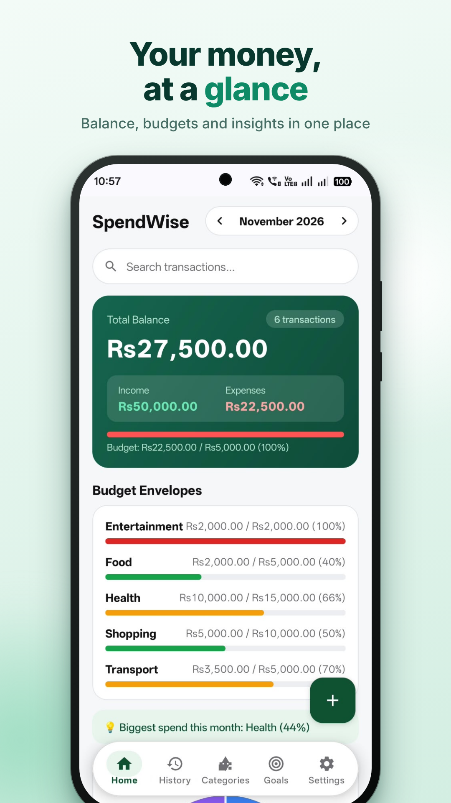
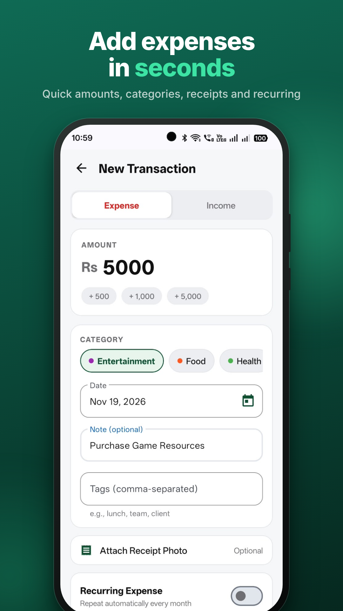
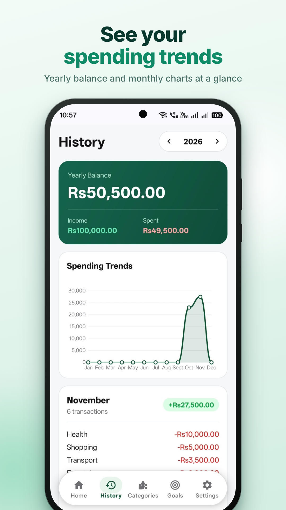
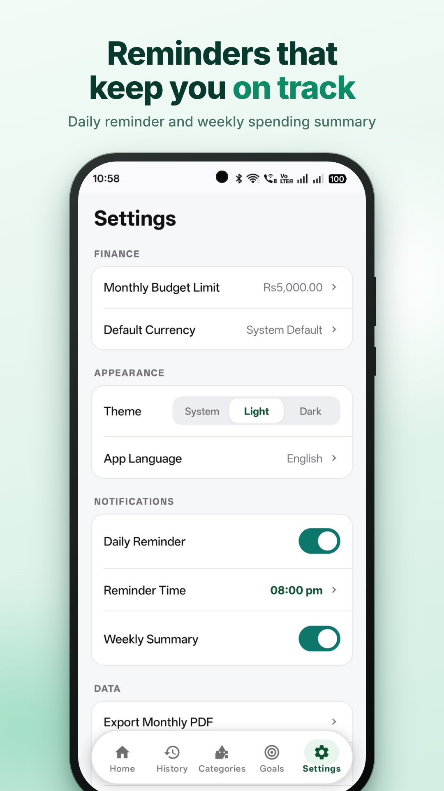

# SpendWise

**Smart. Secure. Simple.**
Your personal finance companion for Android.

  [](https://github.com/chsaad-dev/SpendWise/raw/main/apk/SpendWise-v1.1.0-debug.apk) 

## Download and Install

Download the latest debug build directly on any Android device running Android 7.0 or higher.

**[Download SpendWise v1.1.0 Debug APK](https://github.com/chsaad-dev/SpendWise/raw/main/apk/SpendWise-v1.1.0-debug.apk)** (~7.5 MB)

## Overview

SpendWise is a modern, offline-first Android expense tracker built with Material Design 3. It gives users complete control over their financial data without sending anything off the device. The application handles daily transaction logging, category budgeting, expense splitting, savings goals, and monthly reporting through a clean, fast, and accessible interface.

## Screenshots

| Dashboard | Add Expense | Monthly Analysis | Settings |
| :---: | :---: | :---: | :---: |
|  |  |  |  |

## What is New in v1.1.0

This release is a comprehensive UI overhaul focused on visual refinement, navigation performance, and polish across every screen.

**Visual Design**

A new emerald-based brand identity has been applied throughout the app. The home balance card uses a rich deep-green gradient in Light Mode and a layered charcoal-emerald surface in Dark Mode. All semantic color tokens have been updated for better contrast, consistency, and legibility across both themes.

**Floating Navigation Bar**

The bottom navigation bar has been replaced with a frosted-glass pill that floats above the gesture bar. On Android 12 and above, a RenderEffect blur is applied behind the pill for a genuine glass effect. The bar slides in and out smoothly when navigating to full-screen screens such as Add Transaction.

**Zero-Lag Tab Switching**

The five main tabs (Home, History, Categories, Goals, Settings) now use a show and hide fragment caching strategy instead of replace transactions. Each tab is inflated once and kept in memory. Switching tabs plays a 110ms alpha fade-in and 90ms alpha fade-out with no scale or translation, keeping frame rendering predictable on low-end devices.

**Receipt Viewer**

Attached receipt thumbnails in the Add and Edit Transaction screen are now tappable. Tapping opens a full-screen viewer with pinch-to-zoom, double-tap toggle between 1x and 2.5x, drag-to-pan with boundary clamping, and a dark theater backdrop. The viewer runs edge-to-edge behind the status bar with no content peek-through.

**Theme Selector**

The Dark Mode toggle in Settings has been replaced with a three-segment pill switcher that offers System, Light, and Dark options. The selection is persisted via SharedPreferences and applied immediately using AppCompatDelegate with no Activity restart.

**App Language Bottom Sheet**

The App Language option in Settings now opens a minimalist bottom sheet instead of a plain AlertDialog, consistent with the rest of the modal design language across the app.

**Cold Launch Flash Eliminated**

Empty-state views on Home, History, Categories, and Goals are now hidden by default and only shown after the first Room database emission completes. Charts no longer render a "No data" label during the initial load frame.

**Code and Resource Cleanup**

A non-destructive comment cleanup was performed across all Kotlin source files and XML layouts. Obvious structural comments and AI-generated step markers were removed. Technical comments covering platform workarounds, WAL checkpointing, Room file locking, window inset handling, and RenderEffect usage were preserved.

## Key Features

**Core Functionality**

Income and expense tracking with quick add, edit, and delete for daily transactions. An interactive dashboard shows monthly spending through bar charts, pie charts, and a running total balance. Custom categories can be created and managed with colorful icons and labels. Transaction history supports search and swipe-to-delete.

**Budget Envelopes**

Monthly spending limits can be set per category and tracked visually through progress bars. Overspent categories are highlighted in red. The dashboard shows a smart insight card identifying the largest spending category for the current month.

**Advanced Tools**

Monthly PDF export with a full category breakdown. CSV export for all transactions. Expense splitting among friends or groups with equal and custom split modes. Savings goals with progress tracking. Recurring transactions for automating regular payments. Database backup and restore with WAL checkpointing.

**Notifications**

Daily reminders at a user-configured time and a weekly spending summary delivered via WorkManager-scheduled notifications.

**Offline First**

No internet connection required. All data is stored locally in a Room SQLite database on the device.

## Tech Stack

| Layer | Technology |
|---|---|
| Language | Kotlin |
| Architecture | MVVM with Repository pattern |
| UI | XML layouts with Material Components 3 |
| Database | Room Persistence Library |
| Async | Kotlin Coroutines and Flow |
| Navigation | Jetpack Navigation Component with fragment caching |
| Charts | MPAndroidChart |
| Background work | WorkManager |
| Animations | Lottie |

## Architecture

SpendWise follows MVVM to ensure a clean separation of concerns.

The data layer contains Room database entities, DAOs, and an ExpenseRepository that serves as the single source of truth. The ViewModel layer holds UI state, survives configuration changes, and exposes data through LiveData and StateFlow. The view layer consists of Fragments that observe the ViewModel and render updates reactively.

MainActivity acts as a single-activity shell. It hosts a FrameLayout for the five cached tab fragments and a NavHostFragment for modal destinations such as Add Transaction, Split Expense, and the Welcome guide.

## Project Structure

```
com.example.spendwise
    data                      Room entities, DAOs, Repository
        AppDatabase.kt
        Expense.kt
        ExpenseDao.kt
        ExpenseRepository.kt
    ui
        dialogs               Bottom sheets and dialog fragments
        fragments             Home, History, Categories, Goals, Settings, AddExpense, Split
        viewmodel             MainViewModel
    utils                     CurrencyHelper, NotificationHelper, PdfExportHelper
    MainActivity.kt
    SpendWiseApp.kt
```

## Database Schema

| Entity | Purpose |
|---|---|
| Expense | Transaction amount, date, note, category, receipt path, tags, recurrence |
| Category | Name, icon, color |
| RecurringExpense | Template for automated monthly transactions |
| SavingsGoal | Target amount, deadline, current savings |
| SplitGroup | Header for a shared expense group |
| SplitMember | Member name and owed amount within a group |

## How to Build and Run

**Clone the repository**

```bash
git clone https://github.com/chsaad-dev/SpendWise.git
```

**Open in Android Studio**

Select File > Open and choose the project directory. Allow the Gradle sync to complete.

**Build the project**

```
Build > Make Project
```

**Run on a device or emulator**

Connect an Android device via USB or start an AVD, then click Run or press Shift + F10.

## Requirements

| Requirement | Version |
|---|---|
| Android Studio | Iguana 2023.2.1 or newer |
| Compile SDK | API 36 |
| Min SDK | API 24 (Android 7.0) |
| Target SDK | API 36 (Android 16) |
| JDK | 21 (JetBrains Runtime recommended) |

## Changelog

**v1.1.0 (November 2026)**

UI overhaul release. Frosted-glass floating navigation bar. Zero-lag tab switching with fragment caching. Full-screen receipt viewer with pinch-to-zoom. Three-option theme selector. App Language bottom sheet. Cold-launch empty-state flash eliminated. Lint errors resolved. Version code 6.

**v1.0.4 (November 2026)**

Initial public release. Core expense tracking, category budgets, savings goals, PDF and CSV export, split expenses, recurring transactions, dark mode toggle, daily and weekly notifications.

## Future Plans

Biometric authentication for faster secure access. Optional Google Drive backup for data redundancy. Multi-currency support with real-time conversion.

## License

This project is licensed under the terms described in the [LICENSE](LICENSE) file.

## Author

**Muhammad Saad**
Android Developer

[GitHub](https://github.com/chsaad-dev) | [LinkedIn](https://www.linkedin.com/in/muhammad-saad075/) | [Portfolio](https://saadev.site)
